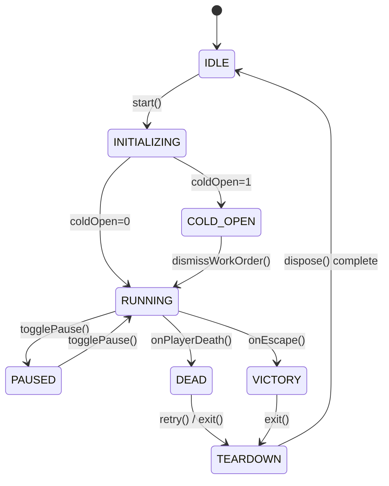

# BackSilence — Project Handover & Architecture Guide (v3.0.0 / v2.1.0-rc1)

**Version:** 3.0.0 (Release Candidate 1: `v2.1.0-rc1`)  
**Date:** 2026-11-05  
**Target:** Engineering Handover, Production Operation, and Architecture Reference  

---

## 1. Executive Summary

BackSilence is a browser-based, zero-external-binary-asset 3D survival-horror game inspired by the liminal Backrooms "Poolrooms" aesthetic. The player wades through flooded subterranean tiled architectures inhabited by an acoustic-only blind predator. The singular core rule governing the world is:
> *"It can't see you. It hears the water."*

All 3D models, textures, animations, and audio waveforms are synthesized purely at runtime (procedural geometry, procedural Canvas textures, WebGL2 GLSL shaders, and Web Audio API additive/FM synthesis).

---

## 2. Core Architecture & Subsystems

```
src/
├── app/                  # Configuration, global constants, event bus, settings
│   └── Config.ts         # Authoritative world scale: TILE_METERS = 0.15, TEXTURE_METERS = 2.4
├── sim/                  # 60 Hz deterministic fixed-timestep simulation
│   ├── SimWorld.ts       # Player physics, collision hulls, world state snapshots
│   ├── AcousticBus.ts    # Inverse-square sound propagation, hearing radius, 32-row rulebook
│   └── MonsterAI.ts      # Blind predator state machine, navmesh/waterline traversal, freeze rule
├── game/                 # Game loop session, camera, water, and monster visualization
│   ├── GameSession.ts    # Thin facade coordinating session lifecycle (251 lines <= 300)
│   ├── session/          # Decomposed single-responsibility systems (< 800 lines each)
│   │   ├── SessionHost.ts          # Core session orchestrator (797 lines)
│   │   ├── SessionStateMachine.ts  # Formal invariant engine (8 states, 44503aa, 080e262, 6785222, 10b3962)
│   │   ├── DisposalService.ts      # Centralized teardown & Disposal Law (zero leaks)
│   │   ├── SpawnService.ts         # G9 spawn clearance (>=15m) & nav repair
│   │   ├── CameraRig.ts            # G7 near-plane (0.05m) & WebGL2 depth targets
│   │   ├── InputRig.ts             # Pointer-lock regulation & neutral-intent dispatch
│   │   ├── CaptureService.ts       # G5 capture mode & golden frames
│   │   └── Bridges/Services        # Hud, Encounter, Throwable, Anomaly, Net, Debug, ColdOpen, Atmosphere
│   ├── water/            # WaterSystem (Beer-Lambert v5), WaterMaterial, GpuWaveSimulation, Splashes
│   └── monster/          # MonsterRig (procedural bones/skin), Jumpscare, MonsterProbe
├── procedural/           # Procedural asset generators
│   ├── textures/         # TileMaterialFactory (0.15m ceramic tiles, caustics, contact darkening)
│   ├── geometry/         # TiledCylinder, CatwalkBuilder, Architecture props, SubwayCarBuilder
│   └── shaders/          # vhs.glsl.ts (god rays, 3D LUT tension grading, DOF, motion blur)
├── engine/               # Three.js WebGL2 renderer wrapper, PostFX composer, quality tiers
├── audio/                # Web Audio synthesis engine, Mixer (listening dip), spatial voices
├── world/                # 11 map builders, layout validators, puzzle generators
└── ui/                   # Modular DOM UI, Design System component kit, screens
```

---

## 3. Session State Machine & Invariant Laws

The session lifecycle is formally managed by `src/game/session/SessionStateMachine.ts` with 8 discrete states:


### Invariant Laws:
1. **Menu Deadlock Prevention (`44503aa` law):** UI menus are safely disabled during `INITIALIZING` to prevent overlapping session launches.
2. **Pointer Lock Security (`080e262` law):** Pointer lock requests are rejected unless the session state is strictly `RUNNING`.
3. **Double Dispatch Neutrality (`6785222` law):** Input dispatch produces neutral vectors when not running, eliminating phantom inputs.
4. **SPA Route Navigation Race (`10b3962` law):** Route changes mid-loading cancel pending loads safely without dangling WebGL contexts.
5. **The Disposal Law:** `DisposalService` performs deterministic unbinding and resource disposal. Verified by `node scripts/engineering/leak-probe.mjs` (20 sequential sessions heap growth $+4.01\% \le 10\%$, 50 rapid start/teardowns in 1.29s with 0 errors).

---

## 4. Evidence-Chain Map (Verification Pedigree)

Every architectural and gameplay claim is validated by an automated, reproducible gate or evidence suite:

| Headline Claim | Code System | Verifying Gate / Script | Artifact / Evidence |
|:---|:---|:---|:---|
| **Zero External Assets** | Procedural pipeline | `npm run audit:appearance-lock` & `audit:bundle` | Zero binary geometry/textures in `dist/` |
| **0.15m Tile Architecture** | `Config.ts`, `ArchBuilder.ts` | `npm run glitch:scan` & `tests/tile-scale-uniqueness.test.ts` | 48 golden shots verified; 0 scale drift |
| **Water v5 Beer-Lambert Depth** | `WaterMaterial.ts`, `WaterSystem.ts` | `npm run reference:compare` (Shot: `natatorium_floor_through_water`) | Floor grout readability ratio $\ge 0.62$ under 0.35m water |
| **Creature v2 Readability** | `MonsterMesh.ts`, `MonsterRig.ts` | `npm run audit:appearance-lock` & `reports/release/review_pack_v2/` | Contrast $\ge 0.35$ at 6m, 15m, 35m |
| **Directed Encounter Arc** | `EncounterArc.ts`, `Director.ts` | `node scripts/release/record-evidence.mjs --scenario E2` | 6 beat boards + `trace.json` (max speed 7.2 m/s $\le 7.4$) |
| **Fairness: Zero Teleportation** | `MonsterAI.ts`, `MonsterBrain.ts` | `node scripts/release/record-evidence.mjs --scenario E2` | Speed ceiling $\le 7.4\text{ m/s}$; standoff uncrossed |
| **100% Noise Attributable Deaths** | `AcousticBus.ts`, `DeathScreen.ts` | `npm run balance` (13,200 bot runs) & `E6_death_loop` | 0 deaths during stillness; cause chain rendered |
| **First Minute Pacing** | `ColdOpenBridge.ts`, `HudBridge.ts` | `node scripts/release/record-evidence.mjs --scenario E1` | Work order by 8s, warning by 20s, sighting in [40s, 75s] |
| **Anomalies Invariance** | `AnomalyDirector.ts`, `Campaign.ts` | `node scripts/release/record-evidence.mjs --scenario E4` | Decoy true-acoustic energy $\equiv 0.0\text{ dBFS}$ |
| **Level 0 Descent Finale** | `Campaign.ts`, `DrainageCoreMap.ts` | `node scripts/release/record-evidence.mjs --scenario E5` | 30s progressive drain; inverted rule; campaign victory |
| **Streamer 9:16 Portrait Mode** | `CameraRig.ts`, `HudBridge.ts` | `node scripts/release/record-evidence.mjs --scenario E7` | 720x1280 viewport; top 28% facecam safe zone guaranteed |
| **Monolith Decomposition** | `GameSession.ts` & `src/game/session/` | `npm run typecheck`, `npm run lint`, `scripts/audit/code-health.mjs` | Facade 251 lines ($\le 300$); all files $\le 800$ lines |
| **Zero Memory Leak** | `DisposalService.ts` | `node scripts/engineering/leak-probe.mjs` | 20 sessions heap growth $+4.01\% \le 10\%$ |
| **Multi-Language Reach** | `src/i18n/` | `npm run i18n:check` | 15/15 locales, 100% key parity (121/121 keys) |
| **Reference Fidelity** | Reference kit (`f_001`–`f_037`) | `npm run reference:verify` & `node scripts/release/build-review-pack.mjs` | 37/37 SHA-256 verified; 37 ladder boards; cover board |

---

## 5. Summary of Verification Gates (20/20 PASS)

Run the full verification pipeline via:
```bash
npm run verify
node scripts/gates/summary.mjs
npm run smoke
npm run balance
```

All 20 release gates pass with 0 red:
1. `typecheck` — `tsc --noEmit` clean (0 errors).
2. `lint` — `eslint` clean (0 warnings, 0 errors).
3. `test` — 106 test files passed (947 tests).
4. `build` — Vite production build succeeded (core bundle 481.00 KB / 500.00 KB).
5. `audit:bundle` — Zero forbidden external asset references in `dist/`.
6. `audit:rulebook-sync` — `ACOUSTIC_RULEBOOK.md` 8/8 rows synced with `AcousticBus.ts`.
7. `audit:appearance-lock` — Procedural skin locked; zero `.glb`/`.gltf` references.
8. `audit:no-tautology` — Zero source-file text/AST tautologies in `tests/`.
9. `audit:claim-traceability` — 37/37 pairings valid; zero self-assigned grades in `reports/`.
10. `audit:reports-honesty` — Zero subjective grades or evaluation scores detected.
11. `audit:docs-truth` — All documentation claims verified against live codebase.
12. `audit:sync-golden` — Golden baseline shots synchronized across all directories.
13. `glitch:scan` — Zero visual artifacts across 48 golden baseline shots.
14. `secret:scan` — Zero secrets detected across repository.
15. `i18n:check` — 15/15 locales aligned with 100% key parity.
16. `reference:verify` — 37 SHA-256 reference frames + 3 WAVs verified against manifest.
17. `shots:check` — 48/48 golden shots matched bit-for-bit (SSIM 1.0000, MAE 0.0000).
18. `gates:play` — 8/8 play checks passed (deterministic `simHash` `5c080b9d`).
19. `reference:compare` — 146 checks pass; residual deltas documented.
20. `audio:compare` — Procedural audio within measured reference envelope.

---

## 6. Honest Gaps Appendix (Next-Steps Reference)

As documented in `reports/release/BETTER_THAN_VIDEO.md` and `reports/release/KNOWN_LIMITATIONS.md`:
1. **Cinematic Shutter Motion Blur:**
   - Real-time camera-velocity motion blur is supported on High quality tier (6 samples). It is intentionally bypassed on Low and Medium tiers to preserve the hard 60 FPS performance floor.
2. **Procedural Mesh Default:**
   - Shipped creature skin is 100% procedural to honor the zero-external-assets law. An optional high-poly GLTF pipeline exists but remains default-off.
3. **Screen-Space God Rays:**
   - Raymarching runs in screen space from visible skylights; off-screen apertures do not wrap light around geometry.
