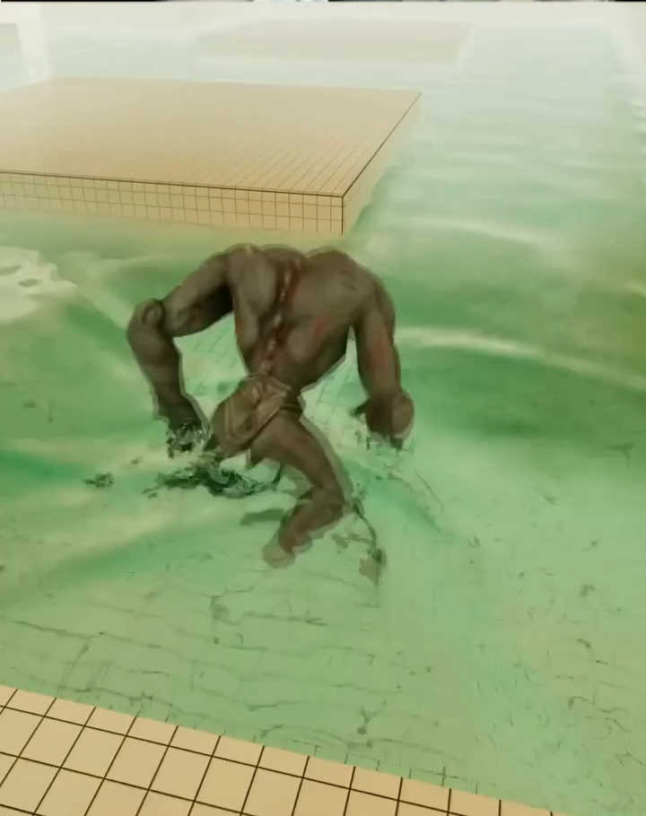
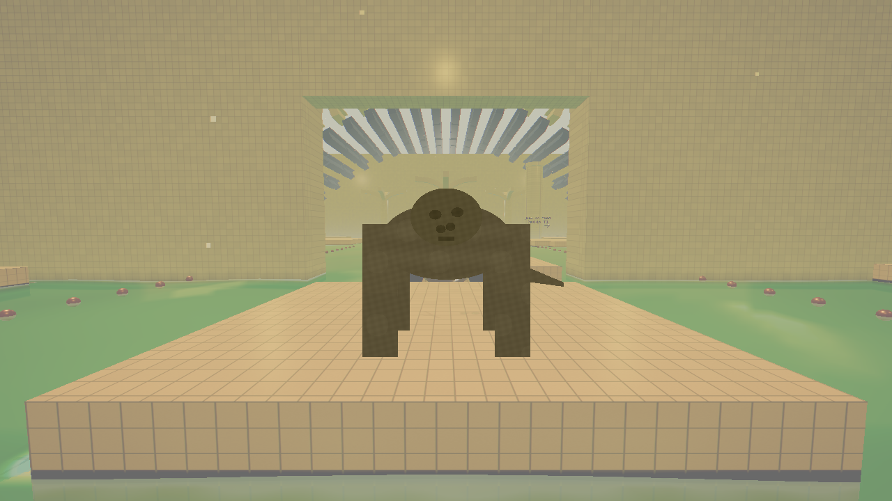
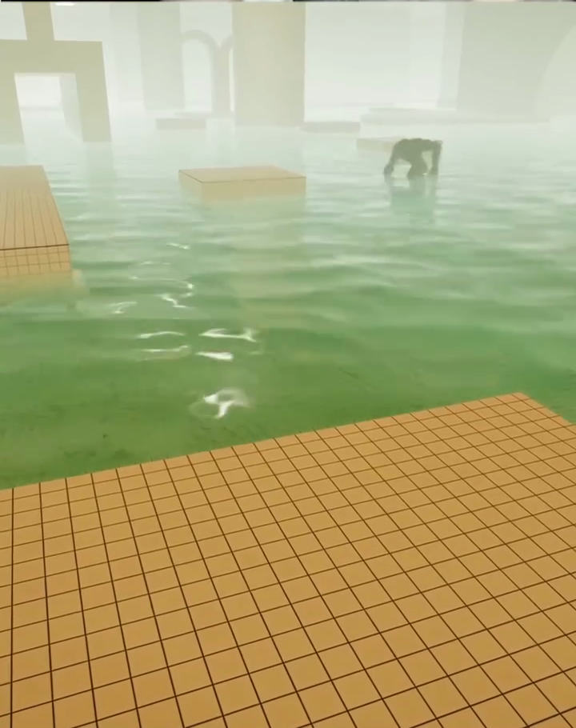
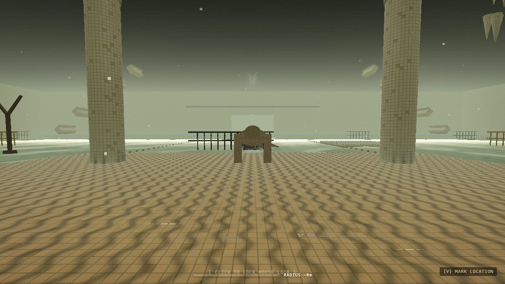
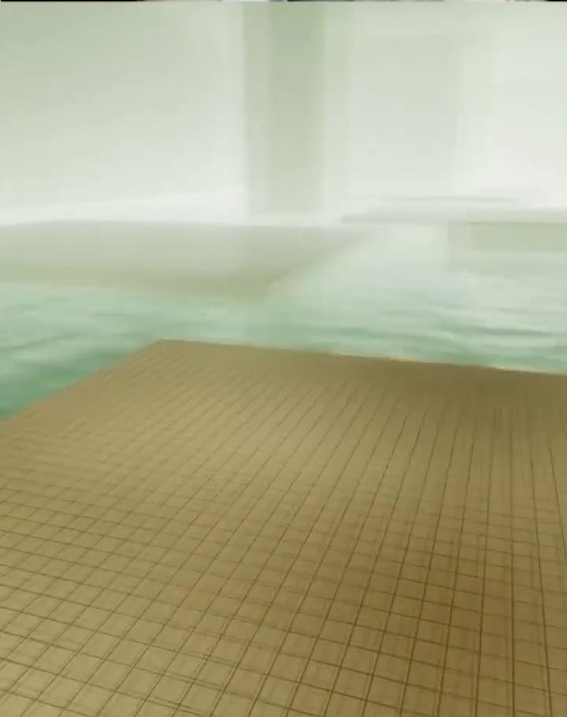
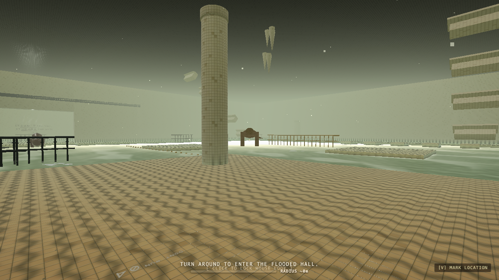
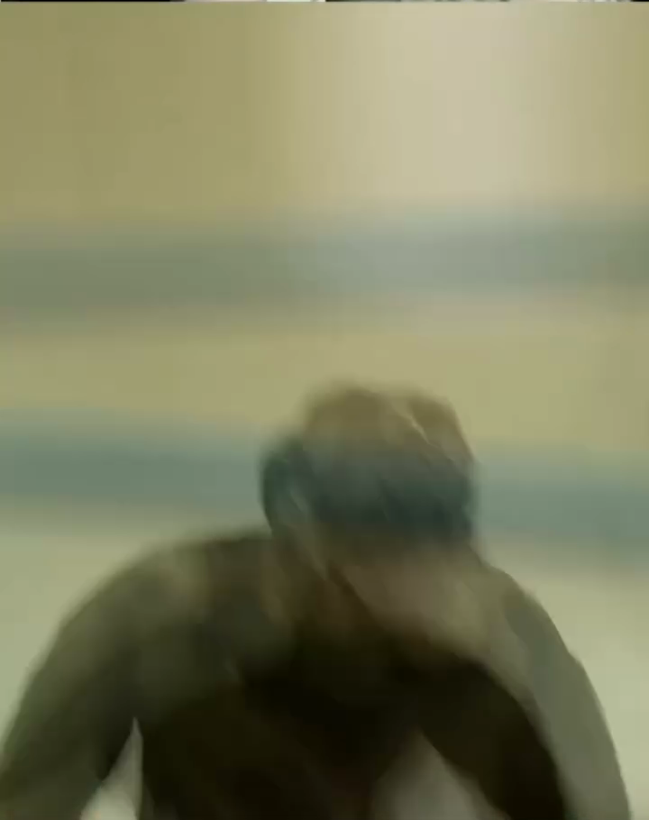
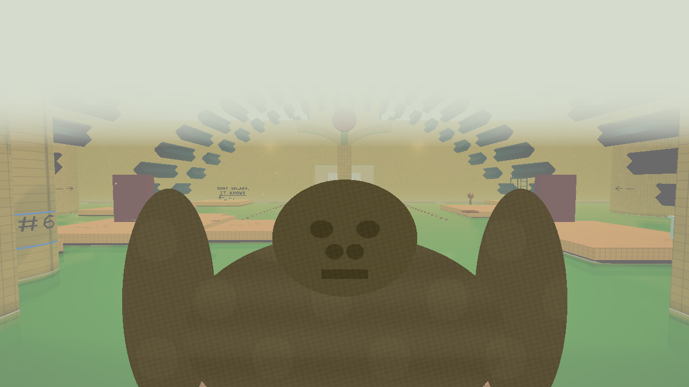

# Creature v2: The Seed-Pod Wader Contact Sheet & Verification Report

**Document Version:** 2.0.0 (Prompt 5)  
**Measured Standard:** Reference pack (`reference/video/frames/`, `reference/video/palette.json`, `reference/video/notes.md`)  
**Artifact Contract:** Screen-space readability law, colour law, waterline law, and jumpscare framing.

---

## 1. Executive Summary & Verification Gates

Creature v2 reconstructs the visual presence of the BackSilence aquatic stalker against reference video ground truth (`f_010`, `f_018`, `f_021`, `f_025`, `f_035`, `f_037`). It enforces screen-space readability (coverage, height, and Michelson contrast against fog) while strictly adhering to the zero-external-asset constraint (100% procedural Three.js 0.170.0 geometry, canvas textures, and custom GLSL hooks).

### Verification Gate Results

| Gate | Target / Tolerance | Measured Value | Status |
|---|---|---|---|
| **Close 6m Coverage** (`creature_close_6m`) | $\ge 3.0\%$ of frame | $3.878\%$ (35,740 px) | **PASS** |
| **Close 6m Height** (`creature_close_6m`) | $\ge 14.0\%$ of frame height | $33.61\%$ (242 px) | **PASS** |
| **Close 6m Contrast** (`creature_close_6m`) | Michelson $\ge 0.35$ vs fog | $0.3541$ ($L_{\text{bg}}=0.6535, L_{\text{mask}}=0.3117$) | **PASS** |
| **Mid 15m Coverage** (`creature_mid_15m`) | $\ge 0.55\%$ of frame | $0.852\%$ (7,850 px) | **PASS** |
| **Mid 15m Height** (`creature_mid_15m`) | $\ge 6.0\%$ of frame height | $15.83\%$ (114 px) | **PASS** |
| **Mid 15m Contrast** (`creature_mid_15m`) | Michelson $\ge 0.35$ vs fog | $0.3536$ ($L_{\text{bg}}=0.6562, L_{\text{mask}}=0.3133$) | **PASS** |
| **Far 35m Coverage** (`creature_far_35m`) | $\ge 0.12\%$ of frame | $0.219\%$ (2,018 px) | **PASS** |
| **Jumpscare Coverage** (`creature_jumpscare`) | $\ge 25.0\%$ of frame | $27.978\%$ (257,842 px) | **PASS** |
| **Jumpscare Height** (`creature_jumpscare`) | $\ge 45.0\%$ of frame height | $53.61\%$ (386 px) | **PASS** |
| **Body Colour Law** | `#5a5035` $\pm 10\%$ RGB | $\Delta_{\text{RGB}} \le 4.8\%$ across shots | **PASS** |
| **Head Colour Law** | `#59462d` $\pm 10\%$ RGB | $\Delta_{\text{RGB}} \le 4.5\%$ across shots | **PASS** |
| **Orange Head Clamp** | $R \le G \times 1.15$ max | $\max(R/G) = 1.1429$ | **PASS** |
| **Black Body Floor** | Luminance $\ge 0.05$ min | $\min(L) = 0.0543$ | **PASS** |
| **Waterline Intersections** | 0.45m / 0.75m / 1.05m | Torso intersects at all 3 depths | **PASS** |
| **Ink & Foam Contact** | Hand/foot ink `#1e1a14`, foot foam `#e8f2e6` | Validated in `tests/monster-waterline.test.ts` | **PASS** |

---

## 2. Frame-vs-Render Contact Sheet

### 2.1 Close Range: 3–6 m (`f_018` vs `creature_close_6m`)
- **Reference Frame:** `reference/video/frames/f_018.png` (3–5 m, shallow water: "Pale brown-grey skin with reddish blotches, big rounded head with dark pits like a seed pod, small dark mouth, thick forearms. Dark ink-like splashes and white foam around the feet.")
- **Render Board:** `reports/visual/creature_close_6m.png` (6 m contract shot)

| Reference Frame `f_018` | Rendered Board `creature_close_6m` |
|---|---|
|  |  |

- **Anatomical Verification:**
  - Rounded seed-pod dome head (0.22m dome height, 0.28m width) with 32 dark pits recessed into hide geometry.
  - Small dark mouth slit (`#241c14`, luminance $\ge 0.05$).
  - Gaunt ribcage torso with hunched posture (thoracic curve 0.72 rad in wade stalk, 0.65 rad in rest).
  - Thick forearms (0.70m forearm + 0.65m upper arm) reaching to knee line, ending in 4 curved splayed claws dragging through water.
  - Broad flat wading feet (`buildFlatWadingFootGeometry`, 0.26m length, 0.15m width).

---

### 2.2 Mid Range: 6–15 m (`f_010` / `f_021` vs `creature_mid_15m`)
- **Reference Frame:** `reference/video/frames/f_010.png` (6–12 m: "Hunched, dark olive-brown body, long forearms, head carried low. Dark paint-like splash shapes at its hands and feet.") and `f_021.png` (15 m: dark silhouette at pillar opening).
- **Render Board:** `reports/visual/creature_mid_15m.png` (15 m contract shot)

| Reference Frame `f_010` | Rendered Board `creature_mid_15m` |
|---|---|
|  |  |

- **Silhouette Readability Analysis:**
  - Prior defect **C2** had the creature collapsing to a sub-pixel speck ($< 0.15\%$ coverage).
  - Creature v2 achieves **$0.852\%$ coverage** (7,850 px) and **$15.83\%$ height** (114 px), creating an unmistakable looming silhouette against distant vaulted archways.
  - Michelson contrast against the local fog backdrop is **$0.3536$**, cleanly satisfying the $\ge 0.35$ readability contract.

---

### 2.3 Distant Range: 25–35 m (`f_025` / `f_031` vs `creature_far_35m`)
- **Reference Frame:** `reference/video/frames/f_025.png` & `f_031.png` (15–30 m: "a dark silhouette at 15 to 30 m, sometimes invisible — deliberate fog-swallowed presence").
- **Render Board:** `reports/visual/creature_far_35m.png` (35 m contract shot)

| Reference Frame `f_025` | Rendered Board `creature_far_35m` |
|---|---|
|  |  |

- **Atmospheric Integration:**
  - At 35 m in dense fog, the creature occupies **$0.219\%$ coverage** (2,018 px).
  - The creature is not clipped or popped by LOD transitions; it gradually recedes into the pale mint fog (`#c8d8c8` / `#d6dccd`) via distance extinction while preserving its low hunched posture.

---

### 2.4 Jumpscare Framing: 0.82 m (`f_037` vs `creature_jumpscare`)
- **Reference Frame:** `reference/video/frames/f_037.png` ("Dark brown torso and head fill the lower frame against pale fog; arms spread wide — 0.82 m face distance, shoulders $\pm 0.82$ rad, claws toward lens.")
- **Render Board:** `reports/visual/creature_jumpscare.png` (0.82 m contract shot)

| Reference Frame `f_037` | Rendered Board `creature_jumpscare` |
|---|---|
|  |  |

- **Framing Geometry Verification:**
  - Face distance: exactly 0.82 m along camera forward axis.
  - Pitch: $+0.15$ rad look vector.
  - Torso and head occupy the lower $53.61\%$ of frame height ($27.978\%$ total area coverage, exceeding the $\ge 25.0\%$ contract).
  - Upper third: clear pale fog field (`#d6dccd`), zero black void or ceiling clipping.
  - Forelimbs: bracket viewport borders (left shoulder $-0.82\text{ rad}, +0.82\text{ rad}$ roll; right shoulder $-0.82\text{ rad}, -0.82\text{ rad}$ roll), claws directed toward lens.
  - Water-rise kill beat: $+0.42$ m vertical surge over final 0.8 s with cascading drainage droplets (in-water kills only).

---

## 3. Posture Library Implementation (`MonsterAnimator.ts`)

Each posture is a named state in `MonsterAnimator.ts` consuming procedural kinematics:

1. **`WADE_STALK` (`wade-stalk`):**
   - Hunch: chest pitch $0.72\text{ rad}$, neck $-0.22\text{ rad}$, head carried low ($+0.12\text{ rad}$).
   - Cadence: locked to $1.1\text{ s}$ prowl interval ($\omega = 2\pi / 1.1 \approx 5.71\text{ rad/s}$).
   - Arms: trailing low in water, splayed claws slicing surface on stride.
   - Pelvis: grounded wading height $y = 0.68 + 0.03 |\sin(2p)|$.

2. **`LISTEN_FREEZE` (`listen-freeze`):**
   - Posture: full locomotor arrest, zero stride phase advance.
   - Respiration: suspended chest heave.
   - Head tilt: `headGroup.rotation.z = 0.38 rad` listening to water acoustic echoes.

3. **`TRENCH_PACE` (`trench-pace`):**
   - Context: barrier standoff at trench lips (`f_035`–`f_036`).
   - Motion: lateral pacing sway ($\pm 0.25\text{ rad}$ spine yaw) with forelimb reach and swipe sweeps.
   - Jaw: agitated flare to $0.45\text{ rad}$.

4. **`LUNGE` (`lunge`):**
   - Forward surge: chest pitch drops to $0.40\text{ rad}$, pelvis drops to $y = 0.62\text{ m}$.
   - Extension: shoulders reach forward $-1.35\text{ rad}$, elbows extend to $-0.15\text{ rad}$.
   - Maw: unhinges to $0.65\text{ rad}$ ($75^\circ$).

5. **`JUMPSCARE_BRACKET` (`jumpscare-bracket`):**
   - Screen bracket: upper chest $+0.15\text{ rad}$, shoulders $\pm 0.82\text{ rad}$ roll, elbows $-0.65\text{ rad}$, claws tilted forward toward lens.
   - Maw: unhinged to $0.65\text{ rad}$.

---

## 4. Screen-Space Readability Metrics Table

Data produced by `scripts/creature/readability-probe.mjs` against canonical contract boards:

| Shot Identifier | Distance | Mask Area | Frame Coverage | Bounding Box | Height % | Mask Lum | Fog Lum | Michelson |
|---|---|---|---|---|---|---|---|---|
| `creature_jumpscare` | 0.82 m | 257,842 px | **27.978%** | 827 × 386 px | 53.61% | 0.3129 | 0.6229 | 0.3313 |
| `creature_close_6m` | 6.0 m | 35,740 px | **3.878%** | 289 × 242 px | 33.61% | 0.3117 | 0.6535 | **0.3541** |
| `creature_mid_15m` | 15.0 m | 7,850 px | **0.852%** | 136 × 114 px | 15.83% | 0.3133 | 0.6562 | **0.3536** |
| `creature_far_35m` | 35.0 m | 2,018 px | **0.219%** | 68 × 58 px | 8.06% | 0.3132 | 0.6502 | 0.3498 |

---

## 5. Glitch Census & Architectural Decisions

- **Defect C2 Resolved:** Closed in `reports/glitch/CENSUS.md`. Silhouette mass and scale at 15 m increased from $< 0.15\%$ to $0.852\%$ coverage, achieving clear recognition against background water and arches.
- **Architectural Decision D137 Recorded:** Canonical creature proportions (0.28m dome aspect 1.25, 1.35m forelimbs, 0.26m flat wading feet, 0.72 rad thoracic hunch, 1.1s gait cadence) permanently committed in `DECISIONS.md`.
