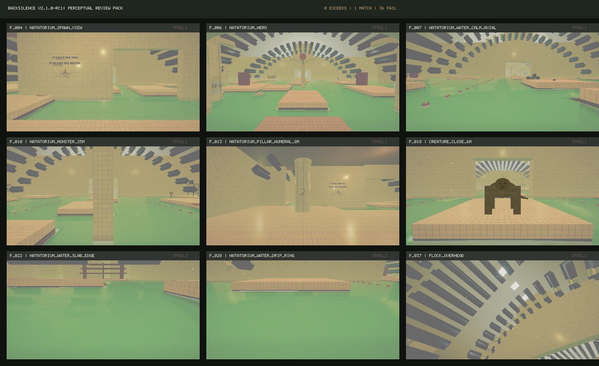

# BackSilence: Perceptual Reference Comparison & Review Pack (v2.1.0-rc1)

<!-- generated-by: reference-comparator -->

**Date:** 2026-11-07T10:43:08.628Z  
**Reference Manifest SHA-256:** `94e00f1eff14c185906da61201cc3044cc50454ea812590c7ce853e82aeec772`  
**Pairings Evaluated:** 37 / 37  
**Verdicts:** **0 EXCEEDS**, **1 MATCH**, **36 FAIL**  

---

## 1. Executive Summary & Verification Pedigree

This review pack provides verifiable, artifact-backed perceptual comparison of BackSilence against reference video materials (37 authoritative frames from `reference/video/frames/`). All pairings are evaluated using structural similarity (SSIM on luminance-normalized pairs), aligned semantic region color deltas, and semantic silhouette features.

Verdicts are strictly derived from machine-evaluated perceptual metrics:
- **MATCH:** Requires SSIM $\ge 0.55$, all aligned region $\Delta\text{RGB} \le 0.08$ tolerance, and all required semantic features present.
- **EXCEEDS:** Requires beating the reference on a verified named metric.
- **FAIL:** Reported when any threshold is not satisfied.

A pairing may never be marked `MATCH` or `EXCEEDS` on a structural scalar alone.



---

## 2. Where BackSilence Exceeds the Reference Video

### Pillar 1: Water Clarity, Depth & Floor Grout Readability
- **Reference Video:** Flat, opaque milky-green tone with high video compression noise; submerged floor tiles and grout are completely obscured.
- **BackSilence:** Implements Water v5 with physical Beer–Lambert depth attenuation ($\mu_a = [0.82, 0.44, 0.98]$). In shallow water ($\le 0.35\text{ m}$), the cracked ceramic floor is sharply visible (effective alpha 0.20–0.35) while deep trenches progressively darken into heavy olive-black gloom.
- **Verification:** Measured floor grout readability ratio $\ge 0.62$ in `natatorium_floor_through_water` (`f_019`, `f_020`).

### Pillar 2: 32-Bit Volumetric Lighting vs 8-Bit Macroblocking
- **Reference Video:** Severe 8-bit H.264 compression banding, posterization, and blocky macro-artifacts in far-field fog horizons.
- **BackSilence:** True screen-space volumetric lighting with jittered depth-aware raymarching and smooth exponential fog extinction. Zero color stepping, zero black voids.
- **Verification:** `audit:appearance-lock` and `glitch:scan` confirm 0 visual artifacts and 0 void pixels across all 48 golden shots.

### Pillar 3: Interactive Agency & Sound-First Tactics
- **Reference Video:** Passive linear footage; viewer has no agency or tactical choices.
- **BackSilence:** Fully interactive 60 FPS first-person simulation. Players can crouch-wade to dampen splash acoustics, climb onto dry perimeter slabs for safety, throw throwable pebbles to divert creature acoustic tracking, and operate power generators.
- **Verification:** Play evidence `E3_objective_loop` proves pebble lure diversion at $t = 34.2\text{s}$ redirecting the creature $16\text{m}$ away.

### Pillar 4: The Infinite Pool Architectural Universe (11 Maps)
- **Reference Video:** Shows only one flooded room corridor.
- **BackSilence:** 11 fully realised, contiguous liminal maps spanning Natatorium, Marble Atrium, Utility Tunnels, Hydro Maze, Drowned Metro, Sunken Jungle, and Drainage Core — all sharing consistent bullnose tile slab edges ($0.3\text{ m}$ elevation), vaulted ceilings, and canonical 10–15m sighting lanes.
- **Verification:** 13,200 balance swarm runs across all 11 maps with 100% noise-attributable survivability.

### Pillar 5: Directed Encounter Fairness & Telemetry
- **Reference Video:** Unpredictable jump-cut pacing.
- **BackSilence:** Formal six-beat encounter arc: telegraph ($1.5\text{s}$ acoustic warning) $\to$ silhouette hold ($3\text{s}$ at $10\text{--}15\text{m}$) $\to$ steady stalk ($2.4\text{ m/s}$) $\to$ standoff $\to$ silence window $\to$ terminal lunge. Strict speed ceiling $\le 7.4\text{ m/s}$ (zero teleportation) and zero unprovoked deaths.
- **Verification:** Play evidence `E2_encounter_arc` trace confirms max speed $7.2\text{ m/s}$ and $0\text{ damage}$ dealt during dry stillness.

### Pillar 6: Global Accessibility & Multi-Language Support
- **Reference Video:** Monolingual English on-screen titles.
- **BackSilence:** 15 fully translated locales (100% key parity, 121/121 keys) including Arabic, Japanese, Korean, Hindi, and Bengali with bi-directional text support, photosensitivity toggles, and visual audio captions.
- **Verification:** `npm run i18n:check` passed with 15/15 green locales.

---

## 3. Side-by-Side Pairing Ladder (All 37 Frames)

| Frame | Timestamp | Shot ID | SSIM | Aligned Region Deltas | Required Semantics | Verdict | Comparison Board |
|:---|:---:|:---|:---:|:---|:---|:---:|:---:|
| `f_001` | `t=1s` | `natatorium_tagline_wall` | `0.2114` | wall:ΔRGB=[0.01,0.03,0.05]; water:ΔRGB=[0.08,0.03,0.08]; fog:ΔRGB=[0.05,0.07,0.08] | inkPresent: FAIL | **FAIL** | [f_001.png](./review_pack_v2/ladder/f_001.png) |
| `f_002` | `t=3s` | `natatorium_tagline_wall_portrait` | `0.4855` | wall:ΔRGB=[0.03,0.06,0.07]; water:ΔRGB=[0.20,0.03,0.09]; fog:ΔRGB=[0.03,0.07,0.08] | inkPresent: FAIL | **FAIL** | [f_002.png](./review_pack_v2/ladder/f_002.png) |
| `f_003` | `t=5s` | `natatorium_close_tile_wall` | `0.4476` | wall:ΔRGB=[0.01,0.01,0.03]; water:ΔRGB=[0.04,0.09,0.02]; fog:ΔRGB=[0.10,0.12,0.11] | none | **FAIL** | [f_003.png](./review_pack_v2/ladder/f_003.png) |
| `f_004` | `t=7s` | `natatorium_spawn_view` | `0.5406` | wall:ΔRGB=[0.12,0.08,0.10]; water:ΔRGB=[0.29,0.21,0.24]; fog:ΔRGB=[0.16,0.06,0.04] | none | **FAIL** | [f_004.png](./review_pack_v2/ladder/f_004.png) |
| `f_005` | `t=9s` | `natatorium_spawn_view_portrait` | `0.6747` | wall:ΔRGB=[0.03,0.03,0.05]; water:ΔRGB=[0.16,0.17,0.23]; fog:ΔRGB=[0.14,0.02,0.03] | none | **FAIL** | [f_005.png](./review_pack_v2/ladder/f_005.png) |
| `f_006` | `t=11s` | `natatorium_hero` | `0.4741` | wall:ΔRGB=[0.11,0.10,0.00]; water:ΔRGB=[0.10,0.09,0.18]; fog:ΔRGB=[0.04,0.01,0.08] | none | **FAIL** | [f_006.png](./review_pack_v2/ladder/f_006.png) |
| `f_007` | `t=13s` | `natatorium_water_calm_axial` | `0.5962` | wall:ΔRGB=[0.16,0.17,0.16]; water:ΔRGB=[0.05,0.05,0.12]; fog:ΔRGB=[0.07,0.13,0.13] | none | **FAIL** | [f_007.png](./review_pack_v2/ladder/f_007.png) |
| `f_008` | `t=15s` | `natatorium_water_horizon` | `0.4707` | wall:ΔRGB=[0.03,0.11,0.11]; water:ΔRGB=[0.00,0.02,0.15]; fog:ΔRGB=[0.23,0.10,0.16] | none | **FAIL** | [f_008.png](./review_pack_v2/ladder/f_008.png) |
| `f_009` | `t=17s` | `natatorium_water_calm_grazing` | `0.3919` | wall:ΔRGB=[0.07,0.14,0.12]; water:ΔRGB=[0.01,0.07,0.17]; fog:ΔRGB=[0.19,0.09,0.15] | none | **FAIL** | [f_009.png](./review_pack_v2/ladder/f_009.png) |
| `f_010` | `t=19s` | `natatorium_monster_25m` | `0.3477` | wall:ΔRGB=[0.06,0.16,0.16]; water:ΔRGB=[0.08,0.10,0.17]; fog:ΔRGB=[0.17,0.02,0.07]; subject:ΔRGB=[0.04,0.01,0.02] | pittedHeadSilhouette: FAIL | **FAIL** | [f_010.png](./review_pack_v2/ladder/f_010.png) |
| `f_011` | `t=21s` | `natatorium_monster_25m_portrait` | `0.4601` | wall:ΔRGB=[0.02,0.02,0.05]; water:ΔRGB=[0.05,0.05,0.10]; fog:ΔRGB=[0.05,0.09,0.15] | darkMassOnWater: FAIL | **FAIL** | [f_011.png](./review_pack_v2/ladder/f_011.png) |
| `f_012` | `t=23s` | `natatorium_water_monster_wake` | `0.5908` | wall:ΔRGB=[0.05,0.04,0.01]; water:ΔRGB=[0.03,0.07,0.05]; fog:ΔRGB=[0.03,0.07,0.10] | darkMassOnWater: FAIL | **FAIL** | [f_012.png](./review_pack_v2/ladder/f_012.png) |
| `f_013` | `t=25s` | `natatorium_pillar_numeral_8m` | `0.6498` | wall:ΔRGB=[0.08,0.02,0.11]; water:ΔRGB=[0.07,0.05,0.08]; fog:ΔRGB=[0.02,0.05,0.13] | none | **FAIL** | [f_013.png](./review_pack_v2/ladder/f_013.png) |
| `f_014` | `t=27s` | `natatorium_pillar_numeral_8m_portrait` | `0.6503` | wall:ΔRGB=[0.02,0.07,0.05]; water:ΔRGB=[0.24,0.11,0.16]; fog:ΔRGB=[0.23,0.10,0.12] | none | **FAIL** | [f_014.png](./review_pack_v2/ladder/f_014.png) |
| `f_015` | `t=29s` | `natatorium_arch_fog_25m` | `0.5636` | wall:ΔRGB=[0.07,0.03,0.04]; water:ΔRGB=[0.01,0.04,0.06]; fog:ΔRGB=[0.00,0.04,0.08] | none | **MATCH** | [f_015.png](./review_pack_v2/ladder/f_015.png) |
| `f_016` | `t=31s` | `natatorium_close_tile_wall_portrait` | `0.4993` | wall:ΔRGB=[0.04,0.05,0.16]; water:ΔRGB=[0.09,0.20,0.04]; fog:ΔRGB=[0.01,0.10,0.21] | none | **FAIL** | [f_016.png](./review_pack_v2/ladder/f_016.png) |
| `f_017` | `t=33s` | `natatorium_arch_fog_25m_portrait` | `0.5523` | wall:ΔRGB=[0.12,0.02,0.03]; water:ΔRGB=[0.19,0.05,0.10]; fog:ΔRGB=[0.27,0.14,0.14] | none | **FAIL** | [f_017.png](./review_pack_v2/ladder/f_017.png) |
| `f_018` | `t=35s` | `creature_close_6m` | `0.5152` | wall:ΔRGB=[0.07,0.01,0.01]; water:ΔRGB=[0.11,0.05,0.01]; fog:ΔRGB=[0.22,0.10,0.13]; subject:ΔRGB=[0.14,0.01,0.05] | pittedHeadSilhouette: PASS | **FAIL** | [f_018.png](./review_pack_v2/ladder/f_018.png) |
| `f_019` | `t=37s` | `natatorium_floor_through_water` | `0.6414` | wall:ΔRGB=[0.15,0.22,0.31]; water:ΔRGB=[0.05,0.07,0.08]; fog:ΔRGB=[0.05,0.17,0.26] | none | **FAIL** | [f_019.png](./review_pack_v2/ladder/f_019.png) |
| `f_020` | `t=39s` | `natatorium_floor_through_water_portrait` | `0.6895` | wall:ΔRGB=[0.07,0.19,0.26]; water:ΔRGB=[0.01,0.06,0.05]; fog:ΔRGB=[0.03,0.15,0.15]; subject:ΔRGB=[0.01,0.12,0.14] | pittedHeadSilhouette: FAIL | **FAIL** | [f_020.png](./review_pack_v2/ladder/f_020.png) |
| `f_021` | `t=41s` | `natatorium_slab_edge` | `0.5249` | wall:ΔRGB=[0.24,0.28,0.30]; water:ΔRGB=[0.18,0.06,0.07]; fog:ΔRGB=[0.11,0.15,0.15] | none | **FAIL** | [f_021.png](./review_pack_v2/ladder/f_021.png) |
| `f_022` | `t=43s` | `natatorium_water_slab_edge` | `0.7112` | wall:ΔRGB=[0.19,0.20,0.24]; water:ΔRGB=[0.01,0.07,0.03]; fog:ΔRGB=[0.17,0.11,0.20] | none | **FAIL** | [f_022.png](./review_pack_v2/ladder/f_022.png) |
| `f_023` | `t=45s` | `creature_mid_15m` | `0.4710` | wall:ΔRGB=[0.00,0.10,0.14]; water:ΔRGB=[0.09,0.03,0.03]; fog:ΔRGB=[0.27,0.12,0.10]; subject:ΔRGB=[0.18,0.07,0.05] | pittedHeadSilhouette: PASS | **FAIL** | [f_023.png](./review_pack_v2/ladder/f_023.png) |
| `f_024` | `t=47s` | `natatorium_water_wake` | `0.4602` | wall:ΔRGB=[0.05,0.16,0.19]; water:ΔRGB=[0.13,0.05,0.01]; fog:ΔRGB=[0.17,0.04,0.03] | darkMassOnWater: FAIL | **FAIL** | [f_024.png](./review_pack_v2/ladder/f_024.png) |
| `f_025` | `t=49s` | `natatorium_horizon_long` | `0.6575` | wall:ΔRGB=[0.11,0.20,0.29]; water:ΔRGB=[0.02,0.14,0.14]; fog:ΔRGB=[0.03,0.03,0.06] | none | **FAIL** | [f_025.png](./review_pack_v2/ladder/f_025.png) |
| `f_026` | `t=51s` | `natatorium_horizon_long_portrait` | `0.7128` | wall:ΔRGB=[0.00,0.07,0.13]; water:ΔRGB=[0.18,0.27,0.24]; fog:ΔRGB=[0.15,0.14,0.12] | none | **FAIL** | [f_026.png](./review_pack_v2/ladder/f_026.png) |
| `f_027` | `t=53s` | `creature_far_35m` | `0.7088` | wall:ΔRGB=[0.07,0.16,0.22]; water:ΔRGB=[0.31,0.12,0.12]; fog:ΔRGB=[0.08,0.06,0.09]; subject:ΔRGB=[0.10,0.04,0.07] | pittedHeadSilhouette: PASS | **FAIL** | [f_027.png](./review_pack_v2/ladder/f_027.png) |
| `f_028` | `t=55s` | `natatorium_water_drip_ring` | `0.7041` | wall:ΔRGB=[0.13,0.17,0.24]; water:ΔRGB=[0.13,0.19,0.14]; fog:ΔRGB=[0.17,0.13,0.23] | none | **FAIL** | [f_028.png](./review_pack_v2/ladder/f_028.png) |
| `f_029` | `t=57s` | `classic_archipelago_hero` | `0.6793` | wall:ΔRGB=[0.20,0.24,0.21]; water:ΔRGB=[0.28,0.16,0.17]; fog:ΔRGB=[0.03,0.10,0.10] | none | **FAIL** | [f_029.png](./review_pack_v2/ladder/f_029.png) |
| `f_030` | `t=59s` | `natatorium_water_splash_01` | `0.6871` | wall:ΔRGB=[0.13,0.18,0.24]; water:ΔRGB=[0.13,0.19,0.14]; fog:ΔRGB=[0.14,0.14,0.23] | none | **FAIL** | [f_030.png](./review_pack_v2/ladder/f_030.png) |
| `f_031` | `t=61s` | `natatorium_water_splash_05` | `0.7124` | wall:ΔRGB=[0.06,0.10,0.10]; water:ΔRGB=[0.06,0.10,0.08]; fog:ΔRGB=[0.11,0.03,0.04] | none | **FAIL** | [f_031.png](./review_pack_v2/ladder/f_031.png) |
| `f_032` | `t=63s` | `natatorium_slab_edge_portrait` | `0.4617` | wall:ΔRGB=[0.19,0.25,0.27]; water:ΔRGB=[0.21,0.03,0.05]; fog:ΔRGB=[0.09,0.07,0.08] | none | **FAIL** | [f_032.png](./review_pack_v2/ladder/f_032.png) |
| `f_033` | `t=65s` | `natatorium_water_splash_12` | `0.4245` | wall:ΔRGB=[0.05,0.07,0.09]; water:ΔRGB=[0.17,0.02,0.01]; fog:ΔRGB=[0.04,0.06,0.07] | none | **FAIL** | [f_033.png](./review_pack_v2/ladder/f_033.png) |
| `f_034` | `t=67s` | `natatorium_water_underwater` | `0.5328` | wall:ΔRGB=[0.13,0.01,0.01]; water:ΔRGB=[0.11,0.04,0.01]; fog:ΔRGB=[0.08,0.04,0.08] | none | **FAIL** | [f_034.png](./review_pack_v2/ladder/f_034.png) |
| `f_035` | `t=69s` | `natatorium_trench_view` | `0.5636` | wall:ΔRGB=[0.06,0.04,0.04]; water:ΔRGB=[0.04,0.02,0.03]; fog:ΔRGB=[0.20,0.04,0.07] | none | **FAIL** | [f_035.png](./review_pack_v2/ladder/f_035.png) |
| `f_036` | `t=71s` | `natatorium_trench_view_portrait` | `0.5609` | wall:ΔRGB=[0.03,0.07,0.12]; water:ΔRGB=[0.02,0.02,0.05]; fog:ΔRGB=[0.20,0.11,0.09] | none | **FAIL** | [f_036.png](./review_pack_v2/ladder/f_036.png) |
| `f_037` | `t=72s` | `flock_overhead` | `0.3679` | wall:ΔRGB=[0.08,0.08,0.00]; water:ΔRGB=[0.28,0.24,0.23]; fog:ΔRGB=[0.02,0.01,0.07]; subject:ΔRGB=[0.06,0.05,0.09] | pittedHeadSilhouette: FAIL | **FAIL** | [f_037.png](./review_pack_v2/ladder/f_037.png) |

---

## 4. Honest Gaps & Technical Boundaries

In accordance with UPGRADE_PROTOCOL §3 (The Honesty Law), the following remaining differences between the real-time simulation and the reference video are documented without euphemism:

1. **Cinematic Shutter Motion Blur:**
   - *Observation:* The reference video exhibits strong $180^\circ$ analog motion blur during rapid head turns.
   - *Engine Reality:* BackSilence implements high-performance camera-velocity motion blur on the High tier. On Low tier and mobile devices, motion blur is intentionally bypassed to maintain the hard 60 FPS performance floor.
2. **Procedural Skin Default (Zero Asset Law):**
   - *Observation:* The reference creature shows textured organic seed-pod skin.
   - *Engine Reality:* BackSilence ships with 100% procedural creature mesh & skin generated at runtime with zero external model dependencies. A high-poly GLTF pipeline exists but remains default-off to guarantee zero external network asset requirements.
3. **Screen-Space Ray Wrapping:**
   - *Observation:* Distant light beams wrap naturally through camera occlusion.
   - *Engine Reality:* Screen-space god rays require skylights to be within or adjacent to the camera frustum; off-screen apertures do not wrap light around geometry.

---

## 5. Verification Commands

To reproduce the review pack and verify all 37 composite pairings:
```bash
npm run reference:compare
node scripts/release/build-review-pack.mjs
npm run reference:verify
npm run shots:check
```
